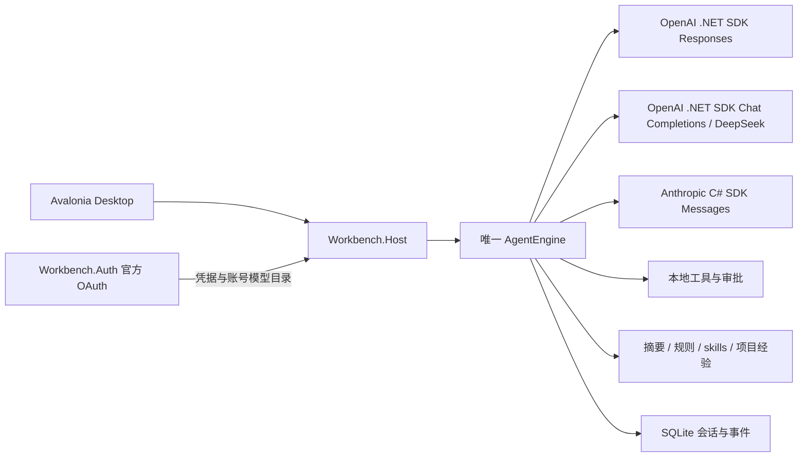

# 统一内核、官方 OAuth 与 Responses 验收

日期：2026-10-30。内部开发代号 Cogito。**严格构建零警告、零错误；272 项测试全部通过，0 失败、0 跳过。** 三端独立包已生成并检查，Windows 包内 Host 后台运行通过。真实 ChatGPT 账号登录/在线推理及 Linux/macOS 实机验证尚未执行；本轮未打开用户桌面或替用户完成授权。

## 当前执行结构



`api` 与 `chatgpt` 现在只区分鉴权来源。它们共用运行循环、工具定义、审批、追加指令、停止、自动摘要、证据召回和恢复路径。已移除委托 Codex app-server 执行的生产项目与相应传输测试。模型服务只提供推理；本次没有启用托管服务端工具。

## 变化与边界

| 范围 | 当前行为 | 核对入口 |
| --- | --- | --- |
| 官方账号 | 官方动态注册 OAuth、PKCE/state/nonce、ID token 校验、轮换令牌续期与受保护存储；支持独立多账号注册、选择、退出、取消登录；兑换失败保留未授权的注册 ID 供重新授权 | `Workbench.Auth`、`account.*` RPC |
| Responses | 官方 OpenAI .NET SDK 2.14.0；流式终态校验，完整输出项、加密 reasoning、phase 与 namespace 回放 | `OpenAiResponsesModel`、`OpenAiResponsesTests` |
| 共用内核 | ChatGPT 同样调用自身的文件工具、摘要、目录规则、`read_skill`、`inspect_evidence`、经验保存/召回 | `UnifiedAgentHostTests`、`AgentEngine` |
| 账号连续性 | 首轮保存账号绑定；每次推理前重新核对凭据归属；切换账号使用新聊天，不能向新账号发送旧 continuation；选择/退出在等待凭据存储或远端撤销前先取消任务 | Host 账号绑定与账号变化处理 |
| 模型能力 | 当前账号模型目录决定可选模型与思考档位；未知档位只用服务默认；图片受预算及模型能力限制 | Host 预检、`ComposerChoices`、后台 UI 测试 |
| 旧历史 | 旧 `codex` 聊天只读保留；继续时新建 Cogito ChatGPT 会话，不导入不完整的外部工具上下文或重放动作 | Host 拒绝旧会话执行；Desktop 迁移提示 |
| 执行权限 | 只读关闭命令/编辑工具，工作区编辑默认审批，完全访问省略审批；所有模型一致 | 这些是工具策略，当前没有操作系统沙箱 |
| API 配置 | 新增 OpenAI Responses API，保留 Chat Completions、DeepSeek、Claude；协议切换创建新聊天 | Desktop 设置、独立 provider 类型 |

OAuth token 不写入会话、模型 continuation、日志或普通 GUI 设置。Windows 使用 DPAPI，macOS 使用 Keychain，Linux 使用 Secret Service/libsecret；系统保护存储失败不会回退明文。平台代码存在不代表三端原生存储已经实机验证。旧 Codex 配置目录保留，不读取已有登录、不删除用户历史。

Responses 原生状态绑定端点、模型与非秘密账号标识。工具只在完整响应通过校验后释放；取消、失败、不完整终态、错误 namespace 或不一致的工具参数不能提交半成品 continuation。自动摘要继续使用本地 `ConversationCompaction`，不会提交远端会话 ID，也不把私有 reasoning 发送给摘要请求。

## 官方依据与开源来源

官方文档于 2026-10-30 核对。账号模型目录使用当前账号凭据获取，推理调用公共 `https://api.openai.com/v1/responses`；账号拥有某模型的目录项仍不等于真实请求必然有权限。[Models and inference](https://developers.openai.com/siwc/token-sharing-open-source/models-and-inference)

首次登录采用官方动态注册流程，回调后验证 ID token、state、nonce 和授予的使用权限，再保存签发的注册与凭据。[Registration and sign-in](https://developers.openai.com/siwc/token-sharing-open-source/sign-in)

ChatGPT plan 路径发送 `store:false`、`stream:true` 与显式输入历史，使用 developer 指令和 namespace function tools，省略 `previous_response_id`、`max_output_tokens` 等该路径不支持的参数。API 密钥模式保留自己的输出上限与普通 function tools。[Preview limitations](https://developers.openai.com/siwc/token-sharing-open-source/preview-limitations)

账号注册独立保存，重新授权复用已有注册和稳定 host ID；退出尝试撤销可续期会话。设置中的用量入口指向官方 [ChatGPT Settings → Usage](https://chatgpt.com/settings/usage)。[Accounts and sessions](https://developers.openai.com/siwc/token-sharing-open-source/profiles-and-sessions)

- [Responses 改编记录与范围](../src/Workbench.Core/Licenses/Responses/PROVENANCE.md)：Pi 固定 commit `e7a0df27c09d11bf4161d3605246cbf57a129cb2`；保留其 [MIT notice](../src/Workbench.Core/Licenses/Responses/Pi-LICENSE.txt)。使用 C# records、异步流、类型化 SDK 事件和有界状态表改写，未移植定价、WebSockets 或完整模型目录。
- [OAuth 协议与依赖来源](../src/Workbench.Auth/Licenses/PROVENANCE.md)：官方 SIWC 协议、Microsoft.IdentityModel.JsonWebTokens 8.23.0 与 Microsoft.Identity.Client.Extensions.Msal 4.92.0；JWT 和系统存储使用成熟库。
- [摘要改编记录](../src/Workbench.Core/Licenses/Compaction/PROVENANCE.md)：Pi/OpenCode 的上下文切点、摘要更新与预留策略及原始许可。
- [项目规则与 skills 来源](../src/Workbench.Core/PROJECT-REUSE.md)：Pi/OpenCode 行为和 YamlDotNet；项目经验是现有事件库上的受约束扩展。

## 后台验收结果

全量结果来自最终源码构建。先前阶段的 239 通过/1 跳过和中间版本的 63 项定向结果保留为历史，本表使用最终 272 项回归。协议夹具使用生成的身份、令牌与工作区；没有借用已有账号登录。以下路径相对源码仓库根目录。

| 检查 | 要验证的行为 | 最终结果 / 证据 |
| --- | --- | --- |
| 严格全量构建与依赖锁 | 全部生产项目、Auth 依赖与 GUI 编译，零警告要求 | `build --no-restore -warnaserror` 通过；三次发布均通过 locked restore 和严格 Release 编译 |
| 全量测试 | 当前源码完整回归；精确通过/失败/跳过数量及 TRX | **272 通过、0 失败、0 跳过**；[TRX](../artifacts/test-results/unified-kernel-final.trx) |
| OAuth 后台夹具 | callback 校验、JWT/scopes、轮换续期、多注册隔离、取消、退出、失败兑换后的注册恢复 | `ChatGptAuthTests` **19 项通过**；包含实际 Windows DPAPI 写入/重开、无明文及独占锁检查 |
| Responses SDK 夹具 | OAuth/API 参数区别、终态、部分流失败、namespace、加密状态回放、凭据回调、安全错误 | `OpenAiResponsesTests` **17 项通过**；API 图片开关与 OAuth 不发送 API 专属输出参数也覆盖 |
| 统一 Host 集成 | ChatGPT 下自身摘要、工具、规则、skills、经验与 SQLite 冷启动；账号切换拦截、只读策略 | `UnifiedAgentHostTests` **7 项通过**；含远端撤销/存储等待时立即取消任务，及 API 密钥共用内核 |
| 真实 Desktop 后台渲染 | 旧聊天迁移、多账号选择、中英文、模型协议隔离、未知思考能力回退，完整输入区 | Composer/ConnectionsProvider/DesktopLocalization 合计 **22 项通过**；真实 Desktop 的 Headless 渲染保存在 [截图目录](../artifacts/ui-composer/)，不占用桌面 |
| 真实 Host + Chat Completions | `verify-host.py` 执行读文件、修改、命令、diff 与证据召回 | **通过**；5 次工具、2 次审批、原文件保留、重启一致；[报告](../artifacts/protocol-/3807ceb8041c462cb9da47f829bb0503/result.json) |
| 真实 Host + Responses | `verify-responses.py` 执行自主读/改/运行，完整状态落盘并冷启动继续 | **通过**；5 次请求、2 次审批、17 个原始事件、三个加法检查通过、续接无重复工具；PATH 与依赖均无 Codex；[报告](../artifacts/verification/unified-responses/09da1295e7a14541b7bea5535e66aedd/result.json) |
| 生命周期与长任务回归 | `verify-lifecycle.py` 和 `verify-continuity.py` | 生命周期 **7 项通过**，含 16 个工作槽占满时停止仍响应；连续性 **11 项通过**，7 次摘要、32 条完整历史、28 次请求；[生命周期](../artifacts/lifecycle/ccb0a6bc8b894aa3b7900db8a406a9bc/result.json)、[连续性](../artifacts/continuity/7467a6626e674a5d90e06db073b675be/result.json) |
| 三端发布与许可检查 | 新包引用 Auth，移除 Codex 依赖，锁文件、许可证和原生组件完整 | `unified-kernel-preview/{win-x64,linux-x64,osx-arm64}` **通过**；331/327/327 文件哈希、每包 6 份源依赖锁、Auth/Responses 许可逐字节比对，无旧执行器或 Headless 依赖；[报告](../artifacts/release-checks/unified-kernel-preview.json) |
| Windows 独立 Host | 清除开发运行时覆盖与模型密钥后，仅使用包内运行时启动 | **通过**；Unicode 会话、真实命令、持久化、退出码 0；实际加载包内 .NET 11 RC3，无模型调用或 GUI |
| 真实 ChatGPT 登录及推理 | 用户授权、账号实际 entitlement、真实平台回调和系统存储 | **未执行**；不能由协议夹具替代 |
| 三端实机 GUI | IME、缩放、终端、系统存储及进程清理 | **按用户安排暂缓** |

可重复执行的后台入口：

```powershell
.tools/dotnet/dotnet.exe build Workbench.slnx --no-restore -warnaserror
.tools/dotnet/dotnet.exe test tests/Workbench.Tests/Workbench.Tests.csproj --no-build --no-restore
python scripts/verify-responses.py
python scripts/verify-host.py
python scripts/verify-lifecycle.py
python scripts/verify-continuity.py
python scripts/verify-release.py artifacts/publish/unified-kernel-preview/win-x64 artifacts/publish/unified-kernel-preview/linux-x64 artifacts/publish/unified-kernel-preview/osx-arm64 --smoke-host --require-source-locks --require-unified-kernel
```

测试发生在源码 Debug 构建后、RID 发布前。发布使用独立依赖锁；再次从发布切回源码开发时先运行 `restore Workbench.slnx --locked-mode` 恢复开发构建资产。三端包自带运行时，Linux/macOS 的原生系统凭据库仍需相应设备验证。

本次未因验证而读取用户已有 Codex 登录、使用真实账户凭据或产生 ChatGPT/Claude 调用费用。旧 DeepSeek 实际调用记录仍在[模型验收](model-core-validation.md)与[连续性验收](continuity-validation.md)，与本次 OAuth 真实调用验证分开。

当前限制还包括：未建立固定仓库任务集的竞品胜率或性能优势；未完成签名安装器、macOS 公证与自动更新；没有复现 ACE/GEPA 等论文的完整训练或反思机制。新的统一路由让这些核心增强能够对所有模型使用，但收益仍需同模型、同预算实验。
