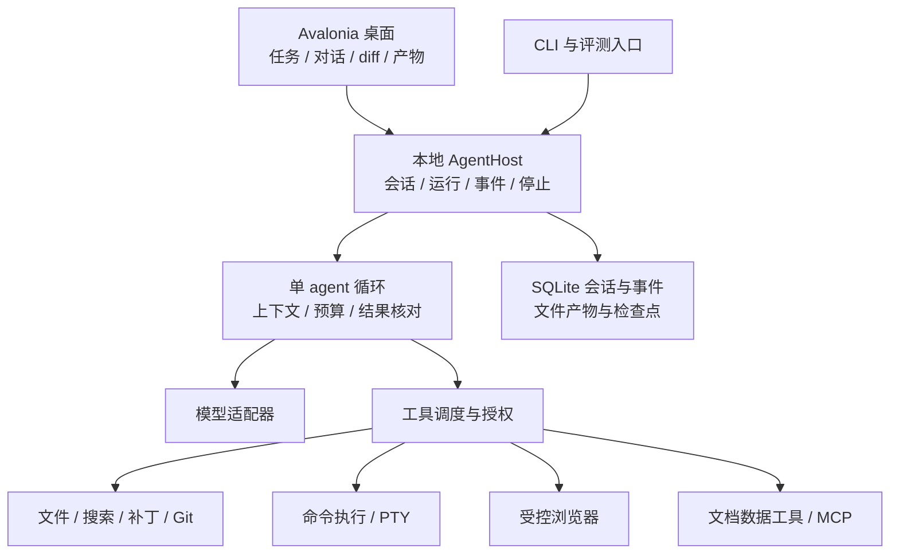

# C# 编码 Agent 的产品架构与实施路线

调研基准日为 2026 年 10 月 30 日。产品定位采用用户最终选择：**编码是主能力，附带少量高频工作能力，提供 Windows、Linux、macOS 桌面 GUI**。本文保留最初的研究与选型基线；产品实现现已推进，实际交付范围和验收证据以[工程状态](../docs/implementation-status.md)为准。尚未训练论文模型或开展竞品付费评测。按用户当前安排，三端实机矩阵暂缓，不阻塞核心与界面开发。

推荐主线是 **C# 15 / .NET 11、Avalonia、自持产品状态与工具契约、可替换模型适配层**。从 Pi、Codex、OpenCode 学执行与交互，从 Aider 学项目上下文，从 Goose 学轻量工作模板；论文机制通过小实验逐项加入。竞争力优先体现在正确完成修改、清楚展示证据、保留用户工作和可靠恢复上。

## 产品范围

### 编码主能力

| 用户任务 | 首版需要的行为 | 完成证据 |
| --- | --- | --- |
| 理解项目与定位问题 | 搜索文件和符号，解释调用关系，引用文件位置，读取项目说明 | 引用能定位到当前版本，结论与实际代码一致 |
| 修复 bug 与实现小功能 | 有目标地修改文件，保留已有未提交内容，处理补丁冲突 | 变更 diff、针对问题的检查、剩余限制 |
| 运行构建与测试 | 流式输出、超时、停止、管理子进程、记录退出状态 | 命令、工作目录、结果和日志可追溯 |
| 审查变更 | 对照基线检查行为回归，必要时运行检查 | 有位置与原因的具体问题；不以泛泛风格意见充数 |
| 长任务继续与调整 | 保存会话，运行中插话，暂停或停止，重启后恢复 | 目标、约束、已完成动作和待验证结果仍然一致 |

先提供轻量代码预览、diff 和跳转外部 IDE，不开发全套 IDE。第一阶段先运行一个写入工作区的 agent；只读检索可并发。并行改代码需要独立 worktree、资源归属和明确集成步骤，放在单 agent 基线稳定之后。

### 高频 work 扩展

这是基于与编码工作相邻程度制定的初始范围，不是已经验证的市场需求占比。通过试用中的实际使用率和任务成功率调整。

| 能力包 | 纳入范围 | 暂时后置 |
| --- | --- | --- |
| 资料检索 | 技术文档、网页搜索、阅读 PDF、来源引用、对比研究 | 无限扩张的深度研究、多级研究群体 |
| 文件与数据 | 整理指定目录，CSV/XLSX 读取、变换和导出，文件生成与预览 | 全功能表格编辑器、后台扫描整个磁盘 |
| 文档产出 | Markdown、短报告、常用 DOCX/PDF 模板和转换 | 自建 Word/PowerPoint 编辑器、复杂排版套件 |
| 浏览器验证 | 测本地 Web 项目、查看文档、截图、少量受控表单工作流 | 接管所有个人浏览器会话、任意第三方桌面操作 |

这些能力共享执行、文件、产物与审批机制；功能按需加载。MCP 接口允许后续扩展，首版不做插件市场、几十种 SaaS 集成、团队后台或全天候个人助手。邮件、日历、消息渠道不作为首版自建功能。

## 架构决策

以下为工程建议，详细来源与替代方案见 [平台选型](platform.md)、[开源机制](opensource.md) 和 [论文研究](papers.md)。

### 界面与执行核心分离

桌面 UI 不持有执行真相，只展示版本化事件并发送用户意图。应用关闭、模型断流和 worker 退出分别处理。产品拥有 `Session`、`Run`、`ToolCall`、`Artifact`、`Approval` 和资源版本；不直接将某个 provider 的响应对象存成永久产品格式。

首版可以是桌面进程与受控的本地 Host 子进程，通过 stdio JSON 消息通信；协议输出与诊断日志分开，带请求 ID、事件序号、版本和背压。UI 重连从已确认事件继续，不重新执行历史工具动作。无需先建设网络 daemon、账户系统或远程调度。

Codex 的 thread/turn/item、双向请求和按版本导出 schema 值得借鉴。其当前官方文档将 WebSocket 标为 experimental；如果加入 Codex 兼容适配器，先固定版本与 stdio 协议，不让内部数据模型跟随上游类型直接变动。[Codex App Server](https://learn.chatgpt.com/docs/app-server)

### 小型自有契约与现成框架结合

模型调用优先复用 `Microsoft.Extensions.AI` 和官方 provider SDK；MCP 使用官方 C# SDK。保留 provider 的工具调用、缓存、图像、结构化结果、取消和计费差异，不能假设所有兼容端点语义相同。

Microsoft Agent Framework 已有可复用的基础设施。P0 用相同工具和回归场景比较 MAF 与小型自有循环，再决定循环实现；无论选择哪一个，GUI、恢复规则和工具授权由产品契约控制。不要同时引入 MAF、Semantic Kernel、AutoGen 三套编排层。[Microsoft.Extensions.AI](https://learn.microsoft.com/en-us/dotnet/ai/microsoft-extensions-ai)、[MAF 官方公告](https://devblogs.microsoft.com/agent-framework/microsoft-agent-framework-at-build-2026-announce/)

建议先划分六个逻辑模块：Contracts、Core、Infrastructure、Tools、Host、Desktop；外加测试与评测项目。模块可以先以目录存在，只有依赖边界或平台条件需要时再拆 assembly。不要为每个工具建立一个微服务。

### 工具执行以结果为准

工具描述应包含输入 schema、读写资源、是否可取消、是否幂等、输出大小限制、执行预算和核对方式。文件编辑先记录基线内容或哈希，提交前检查是否已被用户修改；补丁无法可靠应用时重新读取，避免覆盖用户最新修改。

命令执行至少保存工作目录、参数、启动时间、退出状态、截断信息和完整日志引用。停止首先取消待执行动作，再中止当前操作并处理子进程；网络端可能仍产生费用，GUI 需区分“本地已停止”和“远端状态未知”。普通 stdout/stderr 重定向不等于 PTY，交互式命令单独适配。

一次模型回复、一条工具成功返回和一个任务完成是不同状态。代码任务完成要对应可解释的证据：补丁成功、构建或针对性测试通过、或者清楚说明测试无法执行。模型可以辅助审查，但确定性检查优先。

外部提交后断线时，将操作标为结果未知，先读取目标状态。仅对被确认幂等的操作自动重试；不许把数据库事件回放变成工具动作重放。进程隔离只能改善崩溃隔离，不能被描述为安全沙箱；文件工具的目录约束也不能自动约束任意 shell 命令。

### 上下文先做可解释的检索与压缩

起点是项目说明、文件树、`rg` 搜索、按需读文件、当前 diff 和任务状态。按任务与上下文预算生成相关代码视图；需要时再加入语言服务器、符号图或类似 Aider 的 repo map。不要一开始索引整个用户磁盘，也不要求首先部署向量数据库。

压缩后的任务状态至少保留：当前目标、用户约束、已确认事实及来源、已修改文件、检查结果、未决问题和下一步。原始轨迹仍保留，可按需重载。工具调用与结果不能因压缩失去配对关系。

跨任务记忆初期只保存用户确认偏好、项目约定和带证据的操作经验；记录作用域、来源、版本、有效性和删除状态。把“某次成功的方法”当候选经验，不写成普遍事实。自动更新 skills 的优化工作放在离线评测流程，运行中的用户会话固定技能版本。

### 本地状态与凭据

用 SQLite 事务保存会话、事件和检查点，较大日志、图片、导出文档以独立产物文件保存。设置版本迁移、备份和恢复行为；数据库迁移失败不能悄悄重建并丢失历史。索引先使用轻量全文检索，有证据需要语义检索时再扩展。

模型密钥进入系统凭据设施，日志与分享导出做脱敏；凭据不写入 skills、数据库事件正文或命令行。产品明确区分允许读取的项目范围、写入范围和外部动作授权。用户已经授予的有效范围可复用，超出范围才请求新的决定。

## GUI 的工作流

以“打开项目 → 提交目标 → 看执行与变更 → 运行检查 → 接受结果或继续修改”为主路径。

| 区域 | 显示内容 | 设计重点 |
| --- | --- | --- |
| 左栏 | 项目、会话、运行状态 | 排队、运行、等待输入、失败、完成明确区分 |
| 中栏 | 对话与可折叠执行时间线 | 用户能中途补充信息，清楚看到当前动作 |
| 右侧工作区 | 文件、diff、检查结果、浏览器或产物 | 证据与结果直接可看，不全塞进聊天文本 |
| 持续可见的控制 | 停止、范围、预算与模型 | 停止不藏在菜单里，后台任务仍可找到 |

初版允许用外部 IDE 完成复杂编辑。内嵌编辑器先满足定位、语法高亮、复制、diff 审阅；完整调试器、语言服务管理、扩展市场均后置。终端先提供可靠的命令输出和必要交互，不自写完整终端模拟器。

浏览器执行与 HTML 预览分开。Playwright 使用受控 profile/context；产品内 WebView 用于文档或页面展示，不能因此自动获得产品 Host 的任意调用权限。Playwright 的浏览器二进制和 Linux 系统依赖要计入部署成本。[Playwright 浏览器文档](https://playwright.dev/dotnet/docs/browsers)

## .NET 11 的使用方式

截至基准日，官方最新为 **SDK 11.0.100-rc.3.26522.148**，具有 Go-live 支持，尚非 GA。采用 `net11.0`，用 `global.json` 固定 SDK，GA 后通过兼容性检查升级。[官方下载](https://dotnet.microsoft.com/en-us/download/dotnet/11.0)

C# 15 的 union 与 closed hierarchy 可表达运行状态和工具结果，帮助穷尽处理分支；IPC 和持久化仍使用显式版本化 DTO。Memory safety 仍是独立 preview，不因追求新语法而给普通业务逻辑增加 unsafe。[C# 15 官方说明](https://learn.microsoft.com/en-us/dotnet/csharp/whats-new/csharp-15)

`CancellationToken`、`Channel<T>`、`IAsyncEnumerable<T>`、依赖注入与 JSON source generation 是成熟 .NET 基础能力，适合减少胶水代码，但不是全部在 .NET 11 才出现。11 的运行时和进程接口改进见平台文档，收益要由本产品负载验证。

NativeAOT 先用于兼容性明确的小 worker 做对比。主程序保留自包含 JIT 路线，避免插件、序列化、浏览器或 UI 依赖阻塞整个项目。代码量、冷启动和内存分别测量，不以语言或运行时微基准代替端到端成功率。

## 实施阶段与退出条件

阶段按验收推进，不先承诺固定开发天数。P4 是可在发布后开展的实验，不是首版发布前置条件。当前还没有 SDK，首次实施需要安装固定 .NET 11 SDK，并核验与锁定 NuGet 版本。

| 阶段 | 具体产物 | 进入下一阶段的条件 |
| --- | --- | --- |
| P0 技术可行性 | Avalonia 三端样例、Host 事件协议、模型适配薄层、文件/进程工具；MAF 对照 | 三端真实桌面运行，中文 IME/缩放/长列表通过；运行可取消、状态可保存；选出最少维护成本的循环实现 |
| P1 编码闭环 | 打开仓库、检索、编辑、diff、命令、测试、会话继续 | 独立解决一组冻结小 bug/功能任务；保留已有改动；测试结果可复查；冲突与失败不丢失工作 |
| P2 恢复与上下文 | 中途插话、压缩、检查点、重启恢复、项目级规则、有限 MCP | 流断开、进程退出、用户改文件、工具超时等故障可解释地恢复；不重复执行外部副作用 |
| P3 高频 work | 研究阅读、数据文件处理、简单报告、浏览器验证 | 通过相应留出任务；所有产物可打开检查；复杂任务可降级至明确支持的能力 |
| P4 可选增强实验 | skills 离线优化、只读并发、必要的独立 worktree 并行修改；可在发布后开展 | 同模型/预算下有可重复收益，额外成本受控，状态污染与错误副作用没有被掩盖 |
| P5 发布 | 三端安装、更新、崩溃诊断、导入导出、签名与恢复；依赖 P0–P3 的必要验收，不依赖 P4 | 目标 OS/CPU 矩阵验收；升级保存会话；卸载和凭据删除行为明确 |

三端自身 GUI 属于 P0；控制其他原生桌面应用不属于 P0。后者未来需要分别适配 Windows UIA、macOS Accessibility 与屏幕权限、Linux AT-SPI/Wayland portals，另设能力包。这样不会让主线编码产品被全桌面控制拖住。

## 评测与竞争力验证

### 先建立同条件基线

基线至少包含：最小单 agent 工具循环、自有产品当前版本、同模型下可接入的 Pi 或 OpenCode。Codex 可作产品体验对照；若模型、工具和授权不同，必须报告差异，不能把结果直接归因于 C# 或某个 harness。

每次比较固定任务、仓库 commit、初始未提交文件、OS、模型版本、工具配置、预算、重试和网络条件。文件操作与执行策略改变时需单独成组。代码写得少是维护指标，不能取代正确率。

建议先构建 12 个不依赖模型的故障回归场景和 20 个开发任务，再冻结至少 40 个留出任务作为初步比较集。这里的数量是规划起点，不保证统计功效；正式结论依据误差区间与实际变异决定是否增加样本。代码任务占主要部分，work 任务用于检查小范围扩展是否稳定。

留出任务与技能优化隔离，按仓库或任务家族分组，避免同一 bug 的改写版本跨集合泄漏。保存每次失败与中断，不只挑成功轨迹；重复运行按任务聚类统计，不当作完全独立样本。比较优先使用任务配对结果与置信区间。

### 报告用户真正关心的指标

- **任务正确性：** 独立测试/验收是否通过，修改是否只涉及目标范围，是否破坏已有用户改动。
- **使用成本：** 每次尝试和每个成功任务的 token/费用、p50/p95 耗时、人工介入次数、失败恢复耗时。
- **执行可靠性：** 重复写入、结果未知、取消失败、资源泄漏、上下文压缩后丢约束。
- **桌面体验：** 冷启动、空闲与峰值内存、持续输出时的 UI 延迟、中文输入、长 diff 和长会话滚动。
- **work 产物质量：** 引用是否支持结论、表格是否保留类型与公式、文档是否可打开、浏览器动作是否达到实际目标。

首批实验按成本依次进行：验证与上下文基线、GEPA 思路的离线 skill 优化、显式只读并发与推测预取对照。论文来源、训练要求和 Oral 类型证据详见 [论文研究](papers.md)。不把论文的百分比或倍数当作本产品已获得的收益。

公开 benchmark 只补充其覆盖的能力。BrowserGym 可复用 Web 环境；OSWorld/WindowsAgentArena 更适合将来桌面控制阶段。当前 OSWorld 2.1 将任务与资产放在受访问控制的数据集中，必须固定 release、镜像与 evaluator，不能混用旧版排行榜。[BrowserGym](https://github.com/ServiceNow/BrowserGym)、[OSWorld 2.1](https://github.com/xlang-ai/OSWorld-V2/blob/main/README.md)、[WindowsAgentArena](https://github.com/microsoft/WindowsAgentArena)

## 尚需实施数据决定的取舍

目前可确定语言主线、GUI 优先候选、产品边界和验证方法。以下取舍在对应阶段依据证据决定：MAF 与自有循环的集成成本、Avalonia 的三端编辑器与终端组件组合、何时采用 AOT、哪些 provider 优先、首批 work 文件格式，以及多 agent 是否有净收益。

源码复用前固定 commit 并核对文件级许可证；MIT/Apache-2.0 项目也要保留适用许可与 notices，企业目录、模型权重、数据与第三方资源单独检查。按语义借鉴架构与复制源码分别记账，避免上游变化和许可来源不明。详情见 [开源调研](opensource.md)。
